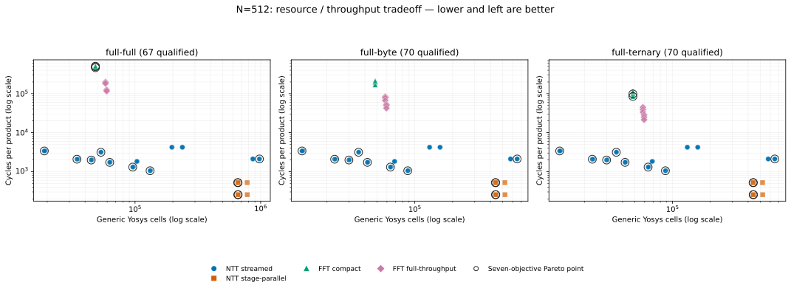
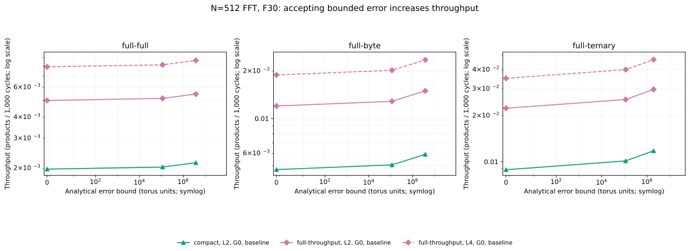
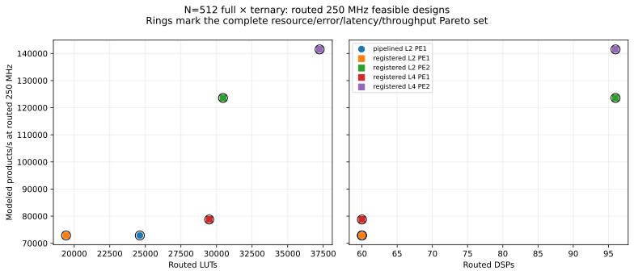
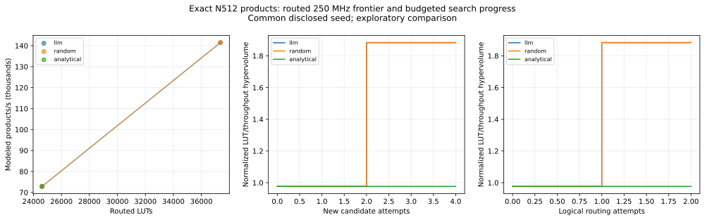

# Polynomial multiplication DSE: results and presentation guide

Present three connected results: a broad NGen/SGen polynomial multiplication
sweep, a physically qualified FPGA shortlist, and a budget-matched adaptive
search experiment. The existing measurements demonstrate the search workflow
and useful hardware tradeoffs. The live LLM experiment ties random search;
it does not yet establish that LLM selection reduces evaluation effort.

## Recommended presentation sequence

| Order | Question | Main document/table | Figure to present |
| --- | --- | --- | --- |
| 1 | What architecture and arithmetic tradeoffs does the grid reveal? | [Polynomial study results](results/polynomial-results.md), N=512 tables | [N=512 resources versus product interval](results/torus512-resource-throughput.svg) |
| 2 | How does approximation change the tradeoff? | Same report, FFT error/throughput section | [FFT error bound versus product interval](results/torus512-error-throughput.svg) |
| 3 | Which designs actually meet routed 250 MHz timing? | [Routed frontier and five-design table](results/pareto250-512.md) | [Routed resources versus modeled throughput](results/pareto250-512.svg) |
| 4 | Can a bounded LLM search acquire useful feasible designs? | [Live policy comparison](results/llm-dse-live-512.md) | [Live area/throughput and search-progress panels](results/llm-dse-live-512.svg) |
| 5 | How can someone use the tool? | [Experiment CLI guide](dse-tool.md) | A locally generated `report.html`; use [published replay panels](results/llm-dse-replay-512.svg) when presenting the recorded fixture |

For a short presentation, use figures 1, 3, and 4, plus the policy comparison
table below. Add figure 2 when approximate arithmetic is part of the discussion.
SVG is preferred for slides and zooming; each linked result report also provides
PNG versions. These figures already exist in the repository; no new hardware
campaign was run to prepare this summary.

## Configuration naming convention

Read a configuration name as **transform family + backend + parallelism +
arithmetic controls + product profile**. The labels below describe the actual
controls used in the published tables; a short label can omit fixed/default
fields. Use the CSV `configuration_json` and workload columns for the complete
configuration rather than inferring omitted settings from a graph label.

Display parameter abbreviations in uppercase: **L, PE, R, G, F, OMIT, ROUND**.
G means stage groups for NTT and guard bits for FFT. Machine-readable field names,
CLI options, paths, and historical candidate identifiers keep their original case;
they are case-sensitive interfaces, not display labels.

### Architecture and profile names

| Name in tables/graphs | Generator/configuration field | Meaning | Design tradeoff or scope |
| --- | --- | --- | --- |
| NTT | `generator: ngen`, `arithmetic: rns` | Modular number-theoretic transforms over an RNS prime basis, followed by CRT reconstruction of the polynomial product. | Exact arithmetic for the qualified product contract; prime count depends on operand bounds. |
| FFT | `generator: sgen`, `arithmetic: split-radix16` | Fixed-point complex FFT products of split base-16 coefficient digits, accumulated into the polynomial result. | Precision and omitted digit products determine the analytical error bound; FFT does not automatically mean approximate output. |
| streamed | NGen `backend: streamed` | Reuses scheduled butterfly processing elements with banked coefficient storage. | PE count controls arithmetic replication; stage groups can add independently buffered engines. |
| stage-parallel | NGen `backend: stage-parallel` | Unrolls the radix-2 stage datapaths, with a registered boundary per NTT stage. | More spatial arithmetic and shorter product intervals in the published grid; PE count is not a tunable replication axis for this backend. |
| compact | SGen `backend: compact` | Reuses FFT hardware across transform work, requiring gaps between datasets. | Lower hardware replication, with a longer transform/product interval. |
| full-throughput | SGen `backend: full-throughput` | Pipelines transform work so transform datasets can follow without inter-dataset gaps. | More hardware replication. The complete split-digit polynomial product still has its own measured interval; the name does not mean one product per cycle. |
| baseline | `profile: baseline`; historical/default product implementation | The generator arithmetic profile is fixed to baseline in these studies. Older product configurations can omit `product_profile`. | Generator `profile` and product `product_profile` are separate fields; read the serialized configuration to distinguish them. |
| pipelined | `product_profile: pipelined` | Adds registers to product arithmetic/reconstruction and changes frame storage to shorten combinational paths. | A product integration choice, independent of streamed versus stage-parallel architecture. |
| registered | NGen `product_profile: registered` | Inherits pipelined arithmetic and adds elastic frame-output registers before pointwise and CRT multiplication. | Improves product boundaries under stalls; it is distinct from the external registered harness. |
| registered-harness-v2 | Target `implementation_context`, not a backend/profile | Registered on-chip source–kernel–sink qualification circuit used for the 250 MHz measurements. | Total physical resources include this harness. It is not part of the architecture label. |

The NGen [backend description](../third_party/NGen/README.md) and SGen
[backend description](../third_party/SGen/README.md) explain generator-level
semantics. These names are scoped to the generator and experiment: do not
substitute an architecture alias from another generator for the recorded backend.

### Parameter abbreviations and identifiers

| Label/example | Configuration field | How to read it |
| --- | --- | --- |
| `N=512` | Workload `n` | Polynomial coefficient count; it is not necessarily the internal FFT length. |
| `full-full`, `full-byte`, `full-ternary` | Workload name and operand ranges | Signed full32 × full32, full32 × signed-byte, or full32 × ternary operands, respectively. |
| `L2`, `L4` | `lanes` | Transform streaming width: coefficients handled per interface beat. It does not directly specify completed products per cycle. |
| `PE1`, `PE2` | NGen `pe` | Reusable butterfly processing elements per streamed stage-group engine. A PE1 field in an older table for another backend is not a swept PE control. |
| `R2`, `R8` | NGen `radix` | Butterfly radix as an actual value, not its base-2 logarithm. |
| `G1`, `G2` | `stage_groups` | Number of contiguous stage partitions with independently buffered PE engines; G2 means two groups, not two stages per group. |
| `barrett`, `montgomery`, `shoup` | NGen `reduction` | Modular reduction/multiplication implementation choice. It does not change the requested polynomial arithmetic. |
| `indexed`, `switch` | NGen `transpose` / boundary column | Transpose/boundary implementation choice; the study's main architecture grid fixes indexed boundaries. |
| `F30` | SGen `fractional_bits: 30` | Fixed-point fractional precision; not the coefficient/output bit width. |
| `G0` | SGen `guard_bits: 0` | Additional guard-bit control used when choosing the FFT arithmetic format. |
| `OMIT0`, `OMIT1`, `OMIT2` | SGen `omit_low_diagonals` | Count of omitted low-weight digit-product diagonals; zero omits none. Larger values can trade an error bound for fewer digit products. |
| `ROUND4` | Row `quant_bits: 4` / output-rounding control | Rounds the final coefficient to a multiple of 16; the analytical rounding error bound is eight torus units. Separate from FFT omissions and fractional precision. |
| `N03`, `S01` | Common-pass report short ID | Row identifier within that particular snapshot, not an architecture parameter. |
| `full-ternary-2be26723e0be400f` | Candidate `name` | Workload prefix plus opaque configuration identity. Resolve it using the report CSV/JSON; the suffix is not a readable parameter encoding. |

### Worked examples

| Published configuration label | Expanded interpretation |
| --- | --- |
| `NTT streamed, L2, R2, G1, shoup, PE1` | NGen exact RNS product using a streamed radix-2 NTT, two lanes, one stage group, one reusable PE per group, and Shoup modular arithmetic. |
| `NTT stage-parallel, L4, R2, G1, montgomery` | NGen radix-2 stage-parallel product with four lanes and Montgomery arithmetic. G1 is a fixed/default field here; it does not turn this backend into a one-engine streamed implementation. |
| `FFT full-throughput, L4, F30, G0, OMIT2` | SGen full-throughput transform backend with four lanes, 30 fractional bits, zero guard bits, and two omitted low digit-product diagonals. The product error bound must be read from its workload-specific result. |
| `registered montgomery L4 PE2` | The physical-frontier table's shortened label: NGen streamed radix-2/G1 product, registered product profile, Montgomery arithmetic, four lanes, and two PEs per group. |
| `NTT stage-parallel, L4, PE1, R2, G1, barrett, baseline` | Display form of the older common-pass configuration: NGen stage-parallel, four lanes, fixed PE1/R2/stage-group fields, Barrett reduction, baseline generator profile. |

## 1. Grid search: architecture and arithmetic

The broad study measures complete negacyclic polynomial products modulo `2^32`.
At N=512 it covers full32 × full32, full32 × signed-byte, and full32 × ternary
operands. NGen supplies streamed and stage-parallel NTT products; SGen supplies
compact and full-throughput FFT products, including two/four-lane full-throughput
variants. Controls include architecture, parallelism, modular reduction, FFT
precision, digit-diagonal omissions, and output rounding where supported.

| N=512 workload | Qualified | Certificate rejected | Timed out | Unsupported combinations |
| --- | ---: | ---: | ---: | ---: |
| full32 × full32 | 67 | 9 | 3 | 102 |
| full32 × signed-byte | 70 | 9 | 0 | 102 |
| full32 × ternary | 70 | 9 | 0 | 102 |
| Total | 207 | 27 | 3 | 306 |

Counts are from the [published grid report](results/polynomial-results.md).
Unsupported combinations are recorded backend exclusions, not completed
hardware evaluations. All three timeouts concern full32 × full32 compact FFT
measurements; they are incomplete measurements, not arithmetic failures.



Explain the figure as a resource/cycle tradeoff: lower interval means more
products per cycle; lower generic cell count means a smaller coarse logic
estimate. Both axes are logarithmic. Rings mark the seven-objective frontier
(error bound, cells, retained memory bits, register bits, multiplier operators,
latency, and interval), so they need not form a two-dimensional envelope.

For example, in the full32 × full32 workload, the exact streamed Shoup L2/PE1
NTT has 18,963 generic cells and a 3,390-cycle interval. The exact stage-parallel
Montgomery L4 NTT has 657,513 cells and a 256-cycle interval. The exact compact
FFT has 48,381 cells and a 505,844-cycle interval. These are useful contrasting
points, not a universal ranking: memory, multipliers, and other objectives also
matter. Generic cells and multiplier operators are not FPGA LUTs and DSPs.



Use the second figure to explain how omitted digit diagonals reduce cycle cost
while increasing the analytical coefficient-error bound. Its symmetric-log
horizontal scale retains the exact zero-error points. Observed corpus maxima
and analytical bounds are different quantities; neither establishes an FHE
application's decryption reliability.

For the earlier controlled 46-design comparison, keep the
[common-pass NGen/SGen report](fhe512-common-frontier.md) and its
[per-configuration tables](measured-evidence/fhe512-common-frontier.md) as
backup. It screened 40 NGen and six SGen configurations and produced 13
seven-objective frontier points, including 11 exact-frontier points. That
snapshot has its own candidate set and synthesis evidence; do not merge its
counts or resource numbers with the later broad study.

The [wider-NTT extension](wide-ntt-search.md) defines a separate sixteen-point
L2/L4/L8/L16 × PE1/PE2/PE4/PE8 campaign. Its measurements are separate from the
published grid above; consult its local results for current progress.

Reproduction: [study setup and commands](polynomial-study.md).
Audit data: [N=512 CSV](results/torus512-points.csv) and
[grid provenance](results/provenance.json).

## 2. Physical feasibility: routed 250 MHz frontier

This narrower experiment fixes exact N=512 full32 × ternary multiplication,
U280 `xcu280-fsvh2892-2L-e`, Vivado 2023.2, Default implementation, and registered
on-chip harness v2. It measures total harness-plus-kernel resources. All five
published designs are routed, timing-feasible, and nondominated within this
measured pool under the full resource/latency/throughput objectives.

| Product profile | Lanes | PEs | LUTs | DSPs | BRAM36 | Interval cycles | Modeled products/s | Setup slack ns | Hold slack ns |
| --- | ---: | ---: | ---: | ---: | ---: | ---: | ---: | ---: | ---: |
| pipelined | 2 | 1 | 24,612 | 60 | 51 | 3,430 | 72,886.3 | +0.063 | +0.011 |
| registered | 2 | 1 | 19,427 | 60 | 60 | 3,430 | 72,886.3 | +0.219 | +0.010 |
| registered | 2 | 2 | 30,457 | 96 | 75 | 2,023 | 123,578.8 | +0.181 | +0.010 |
| registered | 4 | 1 | 29,487 | 60 | 63 | 3,174 | 78,765.0 | +0.113 | +0.012 |
| registered | 4 | 2 | 37,246 | 96 | 66 | 1,767 | 141,482.7 | +0.260 | +0.010 |



The useful headline is **1.94× modeled throughput** relative to the original
pipelined seed, or **21% fewer LUTs at the same product interval** using the
registered L2/PE1 variant. The latter uses more BRAM; this is a tradeoff.
Rates derive from qualified kernel intervals at 250 MHz and the stated bandwidth
assumption. They are not measured board throughput. The on-chip harness does
not qualify external interfaces or board clock delivery. This is a five-design
measured frontier, not an exhaustive FPGA frontier.

Use the [initial timing-closure report](results/timing-closure-512.md) and its
[timing/resource figure](results/timing-closure-512.svg) as backup for signoff
questions. Reproduction and evidence requirements are in the
[device-aware search guide](device-polynomial-search.md).

## 3. LLM design space exploration: live comparison

The live prototype selects from 24 legal exact N=512 full32 × ternary streamed
NTT configurations: two product profiles × two lane counts × two PE counts ×
three modular reductions. Each policy gets the same passing pipelined Montgomery
L2/PE1 seed. It may acquire four additional candidates, four mappings, and two
routings. Failed attempts and cache hits consume the corresponding logical
budgets. The shared promotion scheduler is the same for all policies.

| Policy | Additional candidates | Maps | Routes | Feasible including seed | Best modeled products/s | Normalized hypervolume |
| --- | ---: | ---: | ---: | ---: | ---: | ---: |
| LLM | 4 | 4 | 2 | 2 | 141,482.7 | 1.8838 |
| Seeded random | 4 | 4 | 2 | 2 | 141,482.7 | 1.8838 |
| Analytical heuristic | 4 | 4 | 2 | 1 | 72,886.3 | 0.9764 |



Present all three panels together: routed LUT versus modeled throughput,
hypervolume versus candidate attempts, and hypervolume versus routing attempts.
Hypervolume measures the LUT/throughput tradeoff using a fixed reference and
common-seed normalization. It is not the broad grid's seven-objective metric.
The seed is prior evidence and is excluded from the additional-trial budget.

Across policies, the experiment acquired nine distinct candidates including the
seed and routed six distinct candidates. Shared reuse required five new
qualifications, seven new mappings, and five new routings. Physical execution
counts depend on policy order and cache contents; logical budgets are the fair
comparison axis. The live L4/PE2 winning product is the **pipelined** variant,
with 37,359 LUTs and +0.012 ns setup slack. It differs from the registered
L4/PE2 point in the five-design frontier even though their modeled rates match.

The defensible conclusion is that the adaptive loop produces qualified designs
and inspectable budget/progress evidence. LLM and random tied in this single
seed experiment. There is no measured full 24-design routed reference frontier,
no multi-seed statistical comparison, and no demonstrated LLM advantage or
search-reduction factor. Those require additional experiments.

Methods and reproduction: [LLM search guide](llm-polynomial-search.md).
Audit data: [policy CSV](results/llm-dse-live-512.csv),
[achieved-point CSV](results/llm-dse-live-512-points.csv), and
[metrics/provenance JSON](results/llm-dse-live-512.json).

## 4. Tool demonstration and replay

Use the [unified experiment CLI](dse-tool.md) for a practical demonstration:

```bash
python3 -m architecture_search.dse init experiment.json
python3 -m architecture_search.dse preflight experiment.json
python3 -m architecture_search.dse run experiment.json
python3 -m architecture_search.dse status experiment.json
```

Open `build/dse/experiment/report.html` to show the automatically generated table,
tradeoff/progress graphs, and trial outcomes. The default compares random and
analytical policies offline using five bundled published measurements. Add
`--with-llm` to `init` and supply `LLM_DSE_API_KEY` to demonstrate LLM selection.
See the guide for live evaluation, configuration, resume, and report regeneration.

The [published replay report](results/llm-dse-replay-512.md) and
[replay graph](results/llm-dse-replay-512.svg) record a closed-fixture comparison:
LLM and analytical reached 78,765 modeled products/s; random reached 141,482.7.
Replay performs no new hardware evaluations. Portable replay validates the
bundled records and provenance but does not perform local RTL/checkpoint signoff.
Show replay as an integration/usability demonstration, separately from the live
search result and the broad grid. Fresh LLM calls can choose differently; the
published tables describe their recorded runs.
