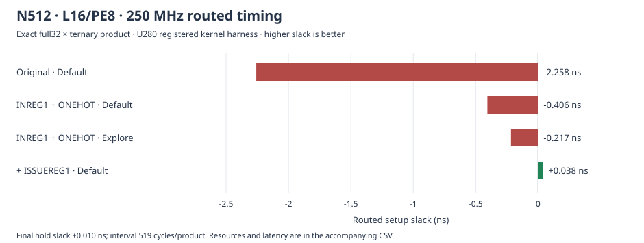

# L16/PE8 timing closure at 250 MHz

**NGen's N512/L16/PE8 full32 × ternary polynomial product meets 250 MHz** on the
U280 registered-harness-v2 target. The achieved Default route has **+0.038 ns
setup slack, +0.010 ns hold slack, and +1.458 ns pulse-width slack**. All setup,
hold, and pulse-width endpoint checks pass; all reported constraint checks are
zero. A separate read-only probe of the saved checkpoint verified that the
buffered global clock net is routed.

This is an exact negacyclic product modulo `2^32`, using streamed Montgomery NTTs,
radix R2, one stage group G1, and registered product integration. N=512, L16, PE8,
operand ranges, target part, 250 MHz clock, and the external product interface
remain the same as the failing original. These are kernel-harness results;
there is no board-shell or measured HBM throughput claim.

## Achieved results

| Native controls | Recipe | Setup ns | Hold ns | LUTs | FFs | DSPs | BRAM36 | Latency cycles | Interval cycles | Meets 250 MHz |
| --- | --- | ---: | ---: | ---: | ---: | ---: | ---: | ---: | ---: | --- |
| Original defaults | Default | -2.258 | +0.010 | 229632 | 33436 | 312 | 96 | 1931 | 509 | No |
| INREG1, BANKWR-ONEHOT | Default | -0.406 | +0.009 | 180258 | 34562 | 312 | 96 | 1933 | 509 | No |
| INREG1, BANKWR-ONEHOT | ExploreHoldFix | -0.217 | +0.001 | 180509 | 34869 | 312 | 96 | 1933 | 509 | No |
| **INREG1, BANKWR-ONEHOT, ISSUEREG1** | **Default** | **+0.038** | **+0.010** | **172138** | **37719** | **312** | **96** | **1953** | **519** | **Yes** |

The final option reduces LUT use by 25.0% relative to the original, increases FF
use by 12.8%, and increases the interval by 2.0%. DSP and BRAM counts are
unchanged. Its modeled compute rate at 250 MHz is about **481696 products/s**
(`250e6 / 519`), before external bandwidth or host limits. The positive setup
margin is small; closure is demonstrated for this exact implementation context
and tool recipe, not guaranteed across seeds, tool versions, or integrations.



[CSV measurements](results/torus512-l16-timing.csv) ·
[JSON snapshot with evidence and artifact hashes](results/torus512-l16-timing.json)

The original RTL's ExploreHoldFix attempt timed out after 3600 seconds and is
excluded from the completed-route table. The final variant passed Default
routing, so no additional Explore attempt was needed for it.

## Native controls and naming

| Label | NGen JSON field | Native CLI | Search axis | Effect |
| --- | --- | --- | --- | --- |
| INREG1 | `input_register: true` | `-input-register` | `input_registers: [true]` | Elastic input beat register before core capture. |
| BANKWR-ONEHOT | `bank_write_arbitration: "onehot"` | `-bank-write-arbitration onehot` | `bank_write_arbitrations: ["onehot"]` | Parallel masked bank-write address/data selection. |
| ISSUEREG1 | `issue_register: true` | `-issue-register` | `issue_registers: [true]` | Register decoded read enables/addresses and aligned operation controls before BRAM access. |

These choices are implemented in NGen and exposed by its native CLI and JSON
DSE interface. The parent framework selects them; it does not patch emitted
core RTL. Defaults preserve legacy behavior, including automatic memory-issue
registration for schedules with at least 1024 bundles. The supported override
scope is complete custom radix-2 streamed/compact Montgomery transforms with a
raw ready-valid interface, indexed transpose, and no runtime control.

The product adapter now honors mid-frame ready deassertion when the native input
register is enabled. Otherwise, the buffered first beat could be accepted while
the core was unavailable and the adapter could advance past an unaccepted beat.
The adapter holds the feed address/data until the handshake succeeds.

See [NGen pipeline controls](../third_party/NGen/docs/pipeline-controls.md) and
[the standalone native L16/PE8 request](../third_party/NGen/examples/dse/ntt512-l16-timing.json).
The native example describes one NTT core; the product spec below applies the
controls to all forward/inverse cores across both CRT primes.

## Why the controls helped

The original worst path starts at the input frame adapter's feed counter,
passes through its asynchronous memory read and the core's priority bank-write
selection, and ends at a BRAM write-data port. It has 5.883 ns data delay and
14 logic levels; routing accounts for 4.431 ns. Input buffering separates the
adapter read from the core, while onehot selection removes the write-priority
chain. NGen checks that scheduled output writes target distinct banks.

The resulting critical path moved to schedule decoding and BRAM read-address
selection: 3.849 ns data delay and 14 logic levels on the Default route. Forcing
the decoded memory-issue register splits this path and keeps the associated
operation controls aligned. It costs one cycle per execution-stage drain;
the measured full-product interval increases from 509 to 519 cycles. Arithmetic
multiplier/reduction partitions retain their defaults.

## Reproduce

Build NGen with `sbt test assembly` in `third_party/NGen`, prepare the existing
pinned study toolchain, and run from the parent repository root:

```bash
scripts/run_polynomial_study.sh \
  --spec studies/torus512-l16-issue-timing.json \
  --output-dir build/polynomial-study-512-l16-issue-timing \
  --configuration-names full-ternary-670a25bf4e113bdc

python3 scripts/device_polynomial_study.py \
  --campaign build/polynomial-study-512-l16-issue-timing \
  --configuration-name full-ternary-670a25bf4e113bdc \
  --target studies/u280-kernel-harness.json \
  --output-dir build/device-polynomial-512-l16-issue-timing \
  --max-trials 1 --route-budget 1 --max-route-budget 1 \
  --timeout 3600 --threads 4
```

The final candidate is `full-ternary-670a25bf4e113bdc`; the input-register/onehot
intermediate is `full-ternary-5427d29ba2dbf1a0`, described by
[the earlier spec](../studies/torus512-l16-timing.json). Final evidence is under
`build/device-polynomial-512-l16-issue-timing/<candidate>/routed/`.
The independent clock probe is under its `clock-check/` directory. A read-only
probe can be reproduced with `scripts.find_timing_met.verify_clock`; it loads the
saved checkpoint and checks the actual BUFG output net's `ROUTE_STATUS`.

## Validation

The final candidate passed 101 independent full-product correctness cases,
64 protocol/backpressure/reset cases, swapped-operand checks, cycle-timing
measurement, and pinned Yosys synthesis. The physical source/sink harness also
passed its independent arithmetic simulation before mapping.

NGen passed 175 Scala tests, 12 adapter tests, and 32 independent-oracle RTL
simulations spanning L2/PE1 through L16/PE8, forward/inverse transforms, one/two
stage groups, stalls and reset with the new controls enabled. Input-register
validation also covered 192 pipeline simulations and complete N16 products in
both operand orders. The parent full suite passed 87 tests, including forced
mid-frame backpressure. Legacy default streamed RTL was byte-identical for
Barrett, Montgomery, and Shoup examples.

The final audit rechecked qualification artifacts, native core metadata,
implementation/checkpoint integrity, the exact original workload and L16/PE8
configuration, 250 MHz target, resource limits, all timing endpoint counts,
constraint completeness, and the saved checkpoint's routed buffered clock.
