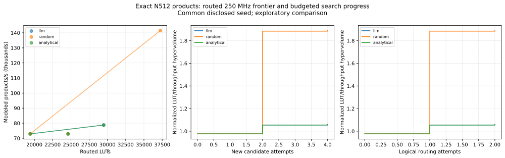

# LLM-guided polynomial multiplication DSE

Mode: **replay**. Exact N=512 full32 × ternary products modulo 2^32; U280, registered harness v2, Default implementation, 250 MHz. Each policy receives the same passing seed as disclosed prior evidence.

| Policy | Status | New candidates | Maps | Routes | Feasible incl. seed | Best modeled products/s | Hypervolume | New physical maps/routes |
| --- | --- | ---: | ---: | ---: | ---: | ---: | ---: | --- |
| llm | complete | 4 | 4 | 2 | 3 | 78765.0 | 1.0597 | 0/0 |
| random | complete | 4 | 4 | 2 | 3 | 141482.7 | 1.8889 | 0/0 |
| analytical | complete | 4 | 4 | 2 | 3 | 78765.0 | 1.0597 | 0/0 |

| Policy | Achieved design | LUT | FF | DSP | BRAM36 | Modeled products/s | Setup ns | Hold ns |
| --- | --- | ---: | ---: | ---: | ---: | ---: | ---: | ---: |
| llm | pipelined montgomery L2 PE1 | 24612 | 12767 | 60 | 51 | 72886.3 | 0.063 | 0.011 |
| llm | registered montgomery L4 PE1 | 29487 | 13308 | 60 | 63 | 78765.0 | 0.113 | 0.012 |
| llm | registered montgomery L2 PE1 | 19427 | 12492 | 60 | 60 | 72886.3 | 0.219 | 0.01 |
| random | pipelined montgomery L2 PE1 | 24612 | 12767 | 60 | 51 | 72886.3 | 0.063 | 0.011 |
| random | registered montgomery L2 PE1 | 19427 | 12492 | 60 | 60 | 72886.3 | 0.219 | 0.01 |
| random | registered montgomery L4 PE2 | 37246 | 16187 | 96 | 66 | 141482.7 | 0.26 | 0.01 |
| analytical | pipelined montgomery L2 PE1 | 24612 | 12767 | 60 | 51 | 72886.3 | 0.063 | 0.011 |
| analytical | registered montgomery L4 PE1 | 29487 | 13308 | 60 | 63 | 78765.0 | 0.113 | 0.012 |
| analytical | registered montgomery L2 PE1 | 19427 | 12492 | 60 | 60 | 72886.3 | 0.219 | 0.01 |

Hypervolume minimizes LUT and maximizes modeled throughput; fixed reference is the target LUT limit and zero throughput, normalized by LUT limit × common-seed throughput. Cache hits consume logical budgets. Physical execution counts depend on shared-cache reuse and policy order.

This is an exploratory single-seed demonstration, not evidence of a statistically established search advantage. Replay is a closed five-design integration fixture; no complete 24-design reference frontier was measured. Products/s are modeled from qualified cycles and the bandwidth assumption, not board measurements.

[Comparison CSV](llm-dse-replay-512.csv) · [Point CSV](llm-dse-replay-512-points.csv) · [Provenance and metrics](llm-dse-replay-512.json)

Across policies: 5 distinct candidates acquired (including the common seed), 4 distinct candidates routed. New physical work: 0 qualifications, 0 mappings, and 0 routings.

[PNG](llm-dse-replay-512.png) · [SVG](llm-dse-replay-512.svg)
