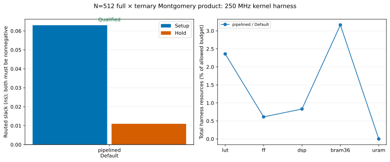

# N=512 polynomial multiplication meeting 250 MHz

The exact full32 × ternary negacyclic product modulo `2^32` meets routed timing
at **250 MHz** on `xcu280-fsvh2892-2L-e` with Vivado 2023.2 and default directives.
Point: `full-ternary-2be26723e0be400f`. It uses streamed Montgomery NTTs, two lanes, one PE,
radix 2, and the `pipelined` product profile.

Qualification covers the complete registered on-chip source–kernel–sink circuit
in `registered-harness-v2`. The signature remains in preserved internal sink
registers, and only the clock is exposed. Resources below include the harness.
Board clock delivery and external data interfaces require their own integration.

| Metric | Routed measurement |
| --- | ---: |
| Setup slack | +0.063 ns |
| Hold slack | +0.011 ns |
| Pulse-width slack | +1.458 ns |
| Failing setup / hold / pulse-width endpoints | 0 / 0 / 0 |
| LUTs | 24,612 |
| FFs | 12,767 |
| DSPs | 60 |
| BRAM36 equivalents | 51 |
| URAMs | 0 |

All required timing-constraint checks passed, DRC contained no errors or critical
warnings, and all five resource categories fit the existing 80% budgets. The
clock report identifies one logical clock, its routed global buffer, and an
additional global buffer serving a high-fanout enable signal. The checkpoint
probe verified both global-buffer output nets have `ROUTE_STATUS=ROUTED`.

The kernel retains its full qualification corpus and protocol checks. The real
kernel and harness also passed a three-product independent integer-schoolbook
scoreboard, including backpressure and signature verification. The unthrottled
kernel qualification measured 8,220 cycles latency and a
3,430-cycle interval. Harness traffic is not a
throughput benchmark.

[Attempt table](timing-closure-512.csv) · [Measurement and provenance](timing-closure-512.json) · [PNG](timing-closure-512.png)

The corrected v2 context used one mapping and one routing attempt, followed by
a read-only clock-routing probe. Earlier v1 harness diagnostics used three
mapping and two routing attempts, including one cancelled route. V1 exposed an
external signature port; its measurements remain separate from the on-chip
qualification. Timing margins are small and describe this implementation run.

The opt-in `registered` fallback also passed full N=512 functional qualification:
latency 8,222 cycles and interval 3,430 cycles. The v2 search stopped at its first
successful product. All 60 Python/RTL tests passed, and rerunning the closure
command reused the sealed implementation and clock-probe evidence.

The local export under `build/timing-closure-512-onchip/exports/full-ternary-2be26723e0be400f/`
contains the kernel, harness, constraints, routed checkpoint, reports and a hash
manifest. See the [reproduction guide](../device-polynomial-search.md#find-one-option-meeting-250-mhz).
